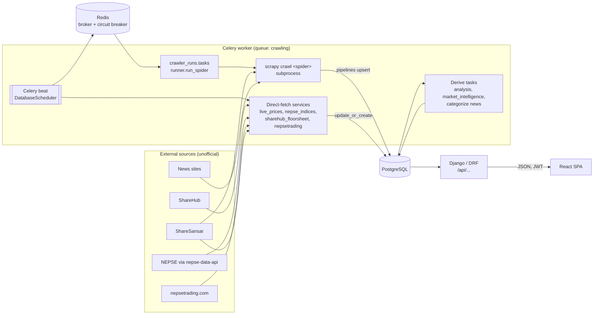

# Architecture

StockScope has three moving parts that share one PostgreSQL database:

1. **Collectors**: Scrapy spiders (`Backend/crawlers/`) plus a few direct HTTP clients in Django services. They run on a Celery beat schedule.
2. **Backend**: a Django + DRF project (`Backend/`) that stores, analyses and serves the data under `/api/`.
3. **Frontend**: a React + TypeScript SPA (`frontend/`) that calls the API with a JWT.

It is not deployed anywhere: it runs on one machine, natively on Windows or with `docker compose` (see [docs/DEPLOYMENT.md](docs/DEPLOYMENT.md)).

## Data flow



## Directory map

```
Backend/
├── config/            settings.py (beat schedule, task routes, thresholds), urls.py, celery.py, settings_test.py
├── apps/<app>/        one Django app per area (layout below)
├── crawlers/          separate Scrapy project
│   ├── runner.py      launches spiders as subprocesses; spider lists (NEWS_SPIDERS, ...)
│   └── crawlers/      settings.py, items.py, pipelines.py (+ market_wide/dividend/ipo pipelines), spiders/
├── data/              seed files: brokers.csv, stock_sectors.csv, company_logos.json, backups/
└── scripts/           one-off scripts (crawl_company_logos.py)
frontend/src/
├── api/               one module per backend area, on top of api/client.ts (axios + JWT refresh)
├── hooks/             TanStack Query wrappers around api/
├── pages/             one file per route (routes in App.tsx)
├── components/        grouped by area: market, brokers, charts, calendar, admin, layout, ...
├── config/            routePermissions.ts (frontend copy of the permission rules)
└── contexts/          AuthContext (user, permissions, tokens)
docs/                  DATABASE, API, DATA_SOURCES, SECURITY, TESTING, DEPLOYMENT, GLOSSARY, status, project-log, features/
```

Every backend app has the same layout:

```
apps/<app>/
├── models.py              tables
├── api/                   urls.py, views.py, serializers.py (thin views)
├── services/              business logic, one file per feature
├── tasks.py               Celery tasks (scheduled in config/settings.py → CELERY_BEAT_SCHEDULE)
├── management/commands/   python manage.py <command>
├── tests/test_<feature>.py
└── README.md              what the app owns
```

## Core components

| App | Owns | Main models |
|---|---|---|
| `users` | Users, roles, permission keys, per-user company access | `User`, `CustomRole`, `RolePermissionConfig`, `UserCompanyAccess`, `Watchlist` |
| `companies` | Company list, tracked companies | `Company`, `TrackedCompany` |
| `market_data` | Daily prices, live prices, movers, heatmap, watchlists, trading calendar | `DailyPrice`, `TradingHoliday`, `LiveFeedStatus` |
| `floorsheet` | Every trade (buyer / seller broker), broker directory, intraday candles | `FloorsheetTransaction`, `Broker`, `IntradayCandle` |
| `reports` | Dividends, EPS, quarterly reports, IPO issues, CSV / XLSX / PDF exports | `DividendAnnouncement`, `CompanyEarnings`, `QuarterlyReport`, `YearlyDPPS`, `IpoIssue` |
| `market_indices` | NEPSE + 13 sub-indices, whole-market daily rows, index replication | `MarketIndex`, `IndexDaily`, `IndexIntradayPoint`, `MarketStockDaily`, `CompanyDaily` |
| `market_intelligence` | ~110 technical indicators (computed on request), breadth, sector rotation, support / resistance | `*Snapshot`, `SupportResistanceSet` |
| `analysis` | Broker accumulation / position, floorsheet grid, daily pressure, volume anomalies, news vs price | `DailyAnalysis`, `VolumeAnomaly`, `NewsPriceCorrelation` |
| `news` | Crawled articles, company tagging, sentiment | `NewsArticle`, `ArticleCompanyTag`, `CategorizationCorrection` |
| `crawler_runs` | Starting spiders and recording each run | `CrawlRun` |
| `dashboard` | Role dashboards and export endpoints | none |
| `market_calendar` | BS / AD month calendar, weekday / day-by-day / month-by-month summaries | none (derived) |

**Dependency direction:** `users`, `companies` → `market_data`, `floorsheet`, `reports`, `market_indices` → `analysis`, `market_intelligence`, `dashboard`, `market_calendar`. Lower layers never import upper ones.

Full table list: [docs/DATABASE.md](docs/DATABASE.md). Endpoints: [docs/API.md](docs/API.md).

## Key scenarios

### Evening price crawl (trading days, 18:00 NPT)

1. Beat fires `crawler_runs.tasks.crawl_daily_prices`, which creates a `CrawlRun` and starts a Celery `chain`: `run_crawl` → `derive_price_fields_task` → `rebuild_all_analysis` → `compute_support_resistance_task` (`apps/crawler_runs/tasks.py`).
2. `run_crawl` calls `crawlers/runner.py::run_spider("trading_data")`, which runs `python -m scrapy crawl trading_data` as a subprocess with a timeout.
3. The spider reads ShareSansar; `TradingDataPipeline` (`crawlers/crawlers/pipelines.py`) upserts `DailyPrice` rows with `source="crawled"`.
4. Later beat jobs build on it: whole-market rows (18:10), floorsheet (18:15), analysis (18:45), market intelligence (19:00).

### Live session (trading days, 11:00–15:15 NPT)

* Every 2 min `market_data.tasks.update_live_prices` calls NEPSE through `nepse-data-api` (`services/live_prices.py`) and writes `Company.ltp`, `session_volume`, `session_turnover`, plus a `LiveFeedStatus` row.
* Every 5 min `market_indices.tasks.snapshot_live_index` stores `IndexIntradayPoint` ticks. After 3 failures in a row a circuit breaker held in Redis stops calls for 30 min.
* Every 5 min `floorsheet.tasks.build_intraday_candles_live` pulls ShareHub trades with times and rebuilds `IntradayCandle`.

### News

Hourly `crawl_all_news` runs the five news spiders in `NEWS_SPIDERS`; `NewsPipeline` upserts `NewsArticle` by URL. Every 10 min `news.tasks.categorize_unprocessed_news_task` tags companies (embeddings + keyword matching, `news/services/categorization.py`). Spec: [docs/features/news-categorization.md](docs/features/news-categorization.md).

### A page request

1. The SPA route is guarded by `PermissionRoute` with a rule from `config/routePermissions.ts`.
2. The `api/` module sends `Authorization: Bearer <access>`; on 401 `api/client.ts` refreshes once (shared promise) and retries.
3. The DRF view checks `HasAppPermission` (`permission_key`) and narrows companies with `apps/users/company_access.py`.
4. The view calls a service; prices come only from `source="crawled"` rows (`market_data/services/price_source.py::with_crawled_price`).

## Frontend route → API → backend

Routes are in `frontend/src/App.tsx`, rules in `config/routePermissions.ts`, pages in `frontend/src/pages/`.

| Route → page | API | Backend |
|---|---|---|
| `/dashboard` → `Dashboard.tsx` | `/api/dashboard/…` | `dashboard/api/views.py` |
| `/market` → `Market.tsx` | `/api/market/summary`, `overview`, `movers`, `heatmap` | `market_data/api/market_views.py` |
| `/market/gainers`, `/market/losers` → `TopMoversPage.tsx` | `/api/market/movers/`, `top-gainers/` | `market_data/services/movers.py`, `top_movers.py` |
| `/market/turnover`, `volume`, `transactions` → `TopActivityPage.tsx` | `/api/market/top-activity/`, `top-*` | `market_data/api/market_views.py` |
| `/market/indices` → `IndicesPage.tsx` | `/api/market-indices/…` | `market_indices/api/views.py` |
| `/market/day-by-day` → `DayByDayPage.tsx` | `/api/market-calendar/months/` | `market_calendar/services/month_summary.py` |
| `/market/month-by-month` → `MonthByMonthPage.tsx` | `/api/market-calendar/monthly/` | `market_calendar/services/monthly_returns.py` |
| `/market/dividends` → `DividendsPage.tsx` | `/api/market/dividends/` | `reports/services/dividends.py` |
| `/market/quarterly-report/:sector` → `QuarterlyReportPage.tsx` | `/api/market/quarterly-report/` | `reports/services/quarterly_reports.py`, `quarterly_metrics.py` |
| `/companies` → `admin/CompaniesPage.tsx` | `/api/companies/` | `companies/api/views.py` |
| `/companies/:symbol` → `StockDetail.tsx` | `/api/companies/<id>/…`, `/api/stocks/<symbol>/intraday/`, `/api/analysis/broker-*` | `companies/`, `floorsheet/`, `analysis/services/broker_accumulation.py` |
| `/floorsheet` → `FloorsheetPage.tsx` | `/api/floorsheet/`, `summary/` | `floorsheet/api/views.py` |
| `/floorsheet/summary` → `FloorsheetSummaryPage.tsx` | `/api/analysis/floorsheet-grid/` | `analysis/services/floorsheet_grid.py` |
| `/technical-charts` → `TechnicalCharts.tsx` | `/api/market-intelligence/…`, `/api/market-indices/…` | `market_intelligence/indicators/`, `services/technicals.py` |
| `/company-analysis` → `CompanyAnalysisDashboard.tsx` | `/api/analysis/…`, `/api/market-intelligence/…` | `analysis/`, `market_intelligence/` |
| `/broker-analysis[/:brokerId]` → `BrokerAnalysisPage.tsx` | `/api/analysis/brokers/…` | `analysis/services/brokers.py` |
| `/top-brokers[/:broker]` → `TopBrokerPage.tsx`, `TopBrokerStocksPage.tsx` | `/api/analysis/brokers/top/`, `brokers/<id>/` | `analysis/services/brokers.py` |
| `/brokers` → `BrokerListPage.tsx` | `/api/analysis/brokers/list/` | `analysis/api/views.py` |
| `/broker-acc-dist` → `AccDistPage.tsx` | `/api/analysis/acc-dist/` | `analysis/services/broker_accumulation.py` |
| `/broker-position` → `BrokerPositionPage.tsx` | `/api/analysis/broker-position/`, `broker-activity/` | `analysis/services/broker_position.py` |
| `/watchlist` → `MyWatchlistPage.tsx` | `/api/market/watchlists/…` | `market_data/api/watchlists.py`, `services/watchlist.py` |
| `/live-trading` → `WatchlistPage.tsx`, `/watchlist-comparison` → `WatchlistComparison.tsx` | `/api/market/…`, `/api/floorsheet/` | `market_data/`, `floorsheet/` |
| `/news[/:id]` → `News.tsx`, `NewsDetail.tsx` | `/api/news/…` | `news/api/views.py` |
| `/crawl` → `CrawlerStatus.tsx` | `/api/crawler-runs/…` | `crawler_runs/api/views.py`, `tasks.py` |
| `/reports` → `ExportPage.tsx` | `/api/reports/export/…` | `reports/exports/` |
| `/users`, `/roles-permissions` → `admin/UserManagementPage.tsx`, `admin/RolesPermissionPage.tsx` | `/api/users/admin/…` | `users/api/views.py` |

`/admin/*` and `/analyst/*` paths redirect to the routes above; `/brokers-distribution` redirects to `/broker-acc-dist`.

## Design decisions

What the code and its comments show; the "why" is quoted from comments where one exists.

| Decision | Where | Reason |
|---|---|---|
| **Tracked companies only** (about 20), except index, dividend, IPO and market-wide broker pages | `companies/services/selection.py::tracked_active_companies` | A focused research set, not a market terminal. TODO: confirm reason. |
| **Real data only**: `DailyPrice.source` separates `crawled` from synthetic `unverified` / `seeded` rows; missing data is shown as missing | `market_data/services/price_source.py` | Synthetic seed rows exist from early development and must never reach charts or analysis. |
| **Each spider runs in its own subprocess** | `crawlers/runner.py` | A run can be killed on timeout (whole process group on Linux). TODO: confirm; probably also because Scrapy's Twisted reactor can't restart inside a long-lived worker. |
| **Pipelines upsert** on natural keys | `crawlers/crawlers/pipelines.py` | Re-running any crawl or backfill is safe. |
| **Worker `--pool=solo`, one queue `crawling`** | `docker-compose.yml`, `CELERY_TASK_ROUTES` | "Required on Windows and works on Linux too" (compose comment). With concurrency 1, tasks run one at a time. TODO: confirm that's also intended to keep sources from being hit in parallel. |
| **Live-feed state in the DB, circuit breaker in Redis** | `LiveFeedStatus`, `market_indices/tasks.py` | Worker and web server don't share Django's per-process cache. |
| **Moved models keep `market_data_*` table names** | `floorsheet`, `reports` models (`db_table`) | Splitting the apps needed no data copy. |
| **One definition of session change** | `market_data/services/movers.py` | Gainers / losers / calendar / weekday pages all agree. |
| **Indicators computed on request, not stored** | `market_intelligence/indicators/registry.py` | Avoids a large table of derived values; they return `None` during warm-up, never 0. |
| **Dates stored in AD; BS conversion only on the backend** via `nepali_datetime` | `market_calendar/services/` | One conversion path; the frontend has no BS library. |
| **Time zone** `Asia/Kathmandu` for Django and Celery, `USE_TZ=True` (DB stores UTC) | `config/settings.py` | Beat times and "today" must match the NEPSE session. |
| **Prices stored as `Decimal`; floats only in computed outputs** (statistics, JSON) | models vs `services/*` | TODO: confirm whether API responses should stay float. |
| **Unofficial sources** | spiders, services | Acceptable for a personal app; check their terms before any public use. |
