# Database

PostgreSQL 16 in development and Docker (`config/settings.py` → `DATABASES`, `CONN_MAX_AGE` 60 s); tests use in-memory SQLite (`config/settings_test.py`). 41 models across 11 apps (`dashboard` has none), managed by Django migrations in `apps/<app>/migrations/`.

This page lists the tables that matter, their natural keys, how they relate, and the rules not visible from the fields. For exact fields read each `models.py`. Every upsert uses the unique keys below, so re-running a crawl or import never duplicates rows. Terms: [GLOSSARY.md](GLOSSARY.md).

## Column conventions

* **Money and prices are `DecimalField`** (80 of them; e.g. `DailyPrice.open` is `max_digits=15, decimal_places=2`). The 7 `FloatField`s are statistics, not money: `VolumeAnomaly.rolling_mean / rolling_std / z_score / pct_of_avg`, `NewsArticle.sentiment`, `ArticleCompanyTag.confidence`, `CategorizationCorrection.previous_confidence`.
* **Datetimes are timezone-aware** (`USE_TZ=True`): stored in UTC, read back in Asia/Kathmandu. Trading dates are `DateField`s in AD.
* **Primary keys** are `BigAutoField` (`DEFAULT_AUTO_FIELD`).

## Tracked companies vs whole market

Most tables hang off `Company` and hold **tracked companies** only. A few hold **every listed stock** keyed by `symbol` instead: `MarketStockDaily`, `CompanyDaily`, `StockSector`, `DividendAnnouncement`, `IpoIssue`. Use those for market-wide pages (indices, Acc/Dist float %, dividends, IPOs). Anything labelled "tracked companies" must come from the `Company`-scoped tables.

## Relationships

```mermaid
erDiagram
    User }o--o| CustomRole : custom_role
    User ||--o{ UserCompanyAccess : ""
    Company ||--o{ UserCompanyAccess : ""
    User ||--o{ Watchlist : ""
    Watchlist ||--o{ WatchlistItem : ""
    Company ||--o{ WatchlistItem : ""
    Company ||--o| TrackedCompany : tracking
    Company ||--o{ DailyPrice : ""
    Company ||--o{ FloorsheetTransaction : ""
    Company ||--o{ IntradayCandle : ""
    Company ||--o{ DailyAnalysis : ""
    Company ||--o{ VolumeAnomaly : ""
    Company ||--o| NewsPriceCorrelation : ""
    Company ||--o{ CompanyTechnicalSnapshot : ""
    Company ||--o| SupportResistanceSet : ""
    SupportResistanceSet ||--o{ SupportResistanceLevel : levels
    Company ||--o{ QuarterlyReport : ""
    Company ||--o{ YearlyDPPS : ""
    Company |o--o{ DividendAnnouncement : "if ours"
    Company |o--o{ IpoIssue : "if ours"
    Company |o--o{ CrawlRun : ""
    User |o--o{ CrawlRun : triggered_by
    CrawlRun |o--o{ RawArticle : ""
    RawArticle ||--o| NewsArticle : ""
    NewsArticle ||--o{ ArticleCompanyTag : ""
    Company ||--o{ ArticleCompanyTag : ""
    NewsArticle ||--o{ CategorizationCorrection : ""
    MarketIndex ||--o{ IndexDaily : daily
    MarketIndex ||--o{ IndexIntradayPoint : intraday
    MarketIndex ||--o{ IndexCalibration : calibrations
    MarketIndex ||--o{ IndexCheck : checks
```

Not linked by foreign key (joined by `symbol` or date): `Broker` (floorsheet `buyer_broker` / `seller_broker` hold the broker number as a string), `MarketStockDaily`, `CompanyDaily`, `StockSector`, `CompanyEarnings`, `TradingHoliday`, the market-wide snapshots.

## companies
| Model | Key | Notes |
|---|---|---|
| `Company` | `symbol` unique | `sector` (free text), `aliases` (JSON list, used for news matching), `is_active`, `created_by` → User. Live fields `ltp`, `previous_close`, `prices_updated_at`, `session_volume`, `session_turnover` are written by `market_data/services/live_prices.py` during the session. `listed_shares` from the admin or `sync_listed_shares`. |
| `TrackedCompany` | one-to-one `company` (`related_name="tracking"`) | `is_tracked`. Read via `companies/services/selection.py::tracked_active_companies()`. |

## market_data
| Model | Key | Notes |
|---|---|---|
| `DailyPrice` | (`company`, `date`) | OHLC, volume, turnover. **`source`** ∈ `crawled`, `seeded`, `manual`, `unverified` (default). Only `crawled` is real; filter with `services/price_source.py::with_crawled_price`. `transactions` is NULL until that day's floorsheet is crawled. `source_change_pct` = ShareSansar's adjusted % change. No previous-close column. |
| `TradingHoliday` | `date` unique | Admin-editable, not crawled. Read through `services/trading_days.py`. |
| `LiveFeedStatus` | single row | Last successful live-feed save. In the DB because the worker and web server don't share Django's per-process cache. |
| *(derived)* session change | n/a | `services/movers.py` is the only definition: each tracked company is a `gainer` / `loser` / `unchanged`, or excluded as `missing_price`, `not_traded`, `missing_previous_session`, `prev_close_zero`, `possible_corporate_action`. |

## floorsheet (tables keep their `market_data_*` names)
| Model | Key | Notes |
|---|---|---|
| `FloorsheetTransaction` | (`company`, `date`, `transaction_id`) | `buyer_broker` / `seller_broker` are broker numbers as strings. `trade_time` only for days loaded from ShareHub. |
| `IntradayCandle` | (`company`, `interval`, `bucket_start`) | 1m–1h candles built from trades with `trade_time`, so only for ShareHub-synced days. |
| `Broker` | `broker_code` unique, `broker_no` | Directory from NEPSE members plus ShareHub (`sync_broker_directory`). |

## reports (tables keep their `market_data_*` names)
| Model | Key | Notes |
|---|---|---|
| `DividendAnnouncement` | (`symbol`, `fiscal_year`), else (`source`, `source_id`) | **Whole market.** `company` set only when the symbol is ours. `status` only moves forward (proposed → AGM → SEBON → distributed). |
| `CompanyEarnings` | (`symbol`, `fiscal_year`, `quarter`) | EPS per quarter. |
| `QuarterlyReport` | (`company`, `fiscal_year`, `quarter`) | Figures as filed; ratios computed per request ([quarterly-report](features/quarterly-report.md)). |
| `YearlyDPPS` | (`company`, `fiscal_year`) | Filled from Q4 rows; feeds the 3-year DPPS average. |
| `IpoIssue` | (`source`, `source_id`) | **Whole market.** IPO / FPO / right share / mutual fund / debenture from ShareSansar. `source_id` = `<type>-<ShareSansar company id>-<units>`, with `-<open date>` (or `-pending`) appended on a clash (`reports/services/ipo_issues.py`). `close_date` earliest closing date, `final_date` latest. |

## market_indices (whole market)
| Model | Key | Notes |
|---|---|---|
| `MarketIndex` | `code` unique | NEPSE plus 13 sub-indices (`seed_market_indices`). |
| `IndexDaily` | (`index`, `date`) | Published OHLC / turnover. **Never store today's row before the close** (the feed reads close 0 / −100% mid-session). History from 2025-10-12 unless backfilled. |
| `IndexIntradayPoint` | (`index`, `recorded_at`) | Live ticks every 5 min in session. |
| `MarketStockDaily` | (`symbol`, `date`) | Daily row per listed stock (spider `market_stocks`, `crawlers/crawlers/market_wide_pipeline.py`). |
| `CompanyDaily` | (`date`, `symbol`) | Close plus listed / public shares and share class, for index replication (`services/index_replication.py`). A stock that didn't trade keeps its last close (`traded=False`). |
| `StockSector` | `symbol` unique | Symbol → sub-index sector (`import_stock_sectors`). |
| `IndexCalibration`, `IndexCheck` | (`index`, `effective_date`), (`index`, `date`) | Replication constant K; daily computed-vs-published check (`needs_recalibration`). |

## analysis
| Model | Key | Notes |
|---|---|---|
| `DailyAnalysis` | (`company`, `date`) | VWAP, return, volume ratio and anomaly flag, buy/sell `pressure` + score + method, `news_count`, `has_sufficient_history`. Rebuilt nightly. |
| `VolumeAnomaly` | (`company`, `date`) | Rolling mean / std / z-score (floats). |
| `NewsPriceCorrelation` | one-to-one `company` | JSON results blob. |

## market_intelligence
| Model | Key | Notes |
|---|---|---|
| `MarketBreadthSnapshot`, `ProxyIndexSnapshot` | `date` unique | Breadth and the "Tracked Basket" index, tracked companies only. |
| `CompanyTechnicalSnapshot` | (`company`, `date`) | Patterns, signal, `sufficient_history`, `possible_corporate_action`. |
| `SectorRotationSnapshot` | (`sector`, `date`) | Sector ranks. |
| `SupportResistanceSet` / `SupportResistanceLevel` | one-to-one `company` / FK `set` | Levels with touches and strength, recomputed after the evening price crawl. |

Indicators are not stored: `market_intelligence/indicators/registry.py` computes about 110 on request. They return `None` during warm-up, never 0.

## news
| Model | Key | Notes |
|---|---|---|
| `RawArticle` | (`source`, `url`) | Raw HTML per fetch; FK `crawl_run`. |
| `NewsArticle` | `url` unique, `content_hash` | Headline, body, `published_at`, sentiment, `is_processed`. `data_provenance` separates real from synthetic articles; read through `news/selectors.py` (`real_articles()`, `real_tags()`). |
| `ArticleCompanyTag` | (`article`, `company`) | `confidence`, `method`, `evidence`, `is_manual` (manual tags are never overwritten). |
| `CategorizationCorrection` | none | Append-only audit of manual tag changes (`corrected_by` → User). |

## crawler_runs
| Model | Key | Notes |
|---|---|---|
| `CrawlRun` | none | One row per spider run: `crawl_type`, `source`, `status`, counters, `errors`, `logs`, `task_id`, `process_id`, optional `company`, `triggered_by`. A standalone `scrapy crawl` records `crawl_type="news"` whatever the spider, so filter by `source`. |

## users
| Model | Key | Notes |
|---|---|---|
| `User` (`AUTH_USER_MODEL = "users.User"`) | `username` (login), `email` unique | `role` ∈ admin / analyst / viewer (default viewer), optional `custom_role`. `get_app_permissions()`: admin gets all keys, otherwise the custom role's list, otherwise the role's `RolePermissionConfig`. |
| `RolePermissionConfig`, `CustomRole` | `role_key`, none | Editable permission lists (keys in `users/api/serializers.py` → `ROLE_PERMISSIONS`). |
| `UserCompanyAccess` | (`user`, `company`) | Per-user allowed companies, on top of role permissions. Only rows with `status=1` and an active company count. Admins are unrestricted; a non-admin with no rows sees **no** companies (`users/company_access.py::get_accessible_company_ids`). |
| `Watchlist` / `WatchlistItem` | (`user`, `name`) / (`watchlist`, `company`) | Named lists, one `is_default`. Items hold `units` and `wacc` (Decimal). |

Also installed: `django_celery_beat` tables (beat schedule, `DatabaseScheduler`) and `token_blacklist` (SimpleJWT rotated refresh tokens).

## Data rules

* Never insert or keep made-up prices. Delete non-`crawled` `DailyPrice` rows rather than relabel them.
* Don't store today's `IndexDaily` row before the close.
* `Backend/data/backups/` holds old dumps. Nothing reads them at runtime; `data.json` contains an old superuser row (see [SECURITY.md](SECURITY.md)).
